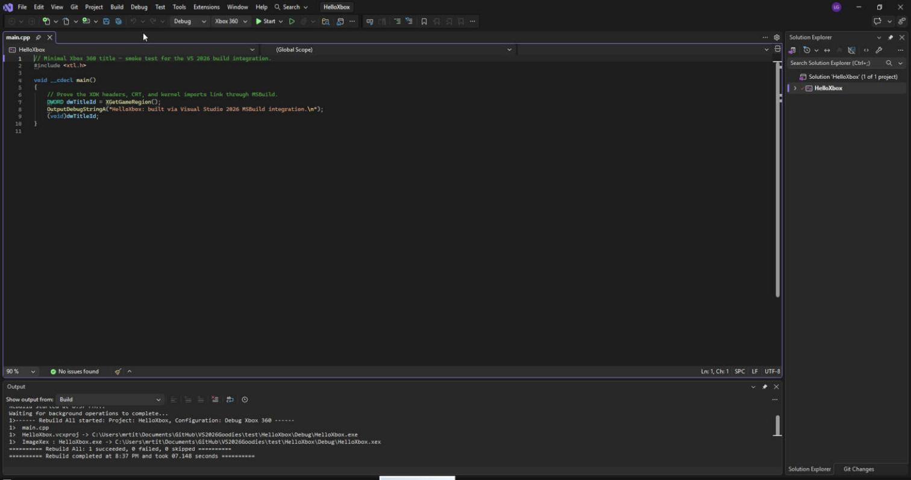
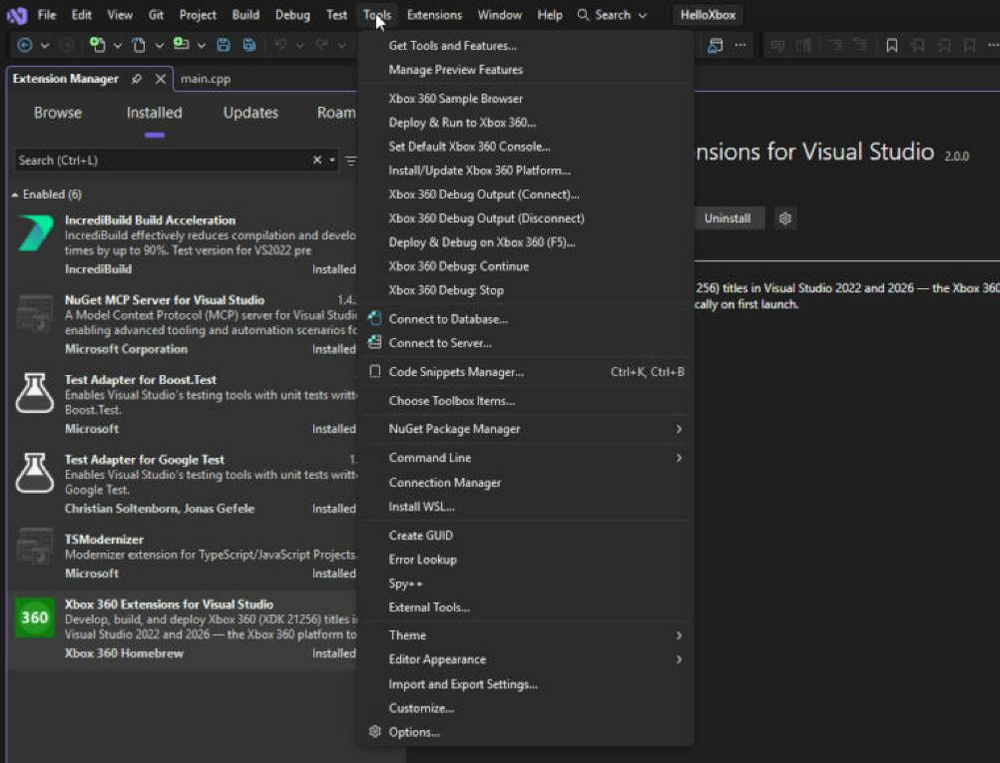
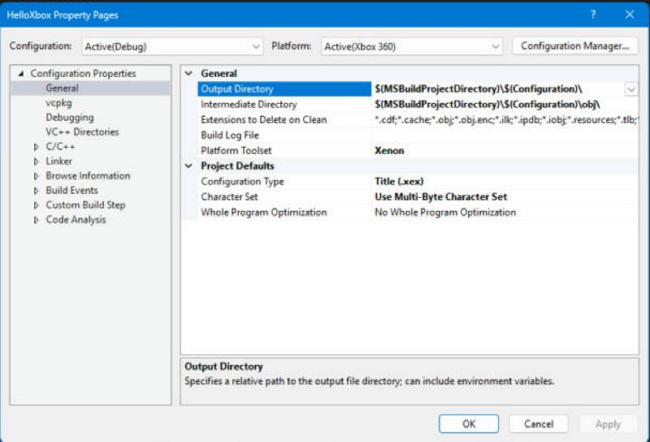
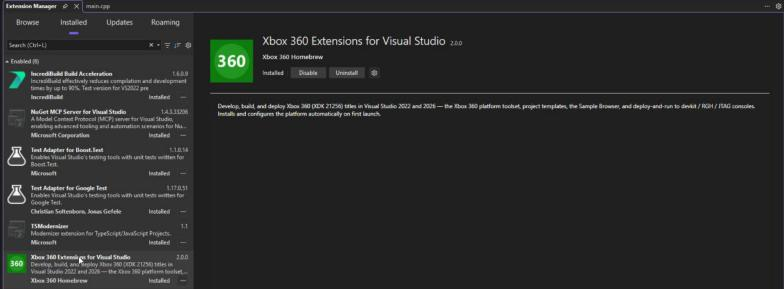

<h1 align="center">Xbox 360 Extensions for Visual Studio 2022 / 2026</h1>

<p align="center">
  <strong>Full Xbox 360 title development inside a modern, 64-bit Visual Studio —
  build, deploy, launch, and live debug output on a real console.</strong>
</p>

---

<p align="center">
  
  <br><sub>HelloXbox rebuilt for Xbox 360 inside Visual Studio 2026 — <code>cl</code> → <code>link</code> → <code>ImageXex</code> produce a <code>.xex</code>.</sub>
</p>

## What this is

A Visual Studio extension (`Xbox360Package.vsix`) and supporting toolchain that
revives Xbox 360 XDK development on Visual Studio 2022 and 2026. It wires the
XDK 21256 build tools (`cl.exe`, `link.exe`, `imagexex.exe`, `xbcp.exe`) into
MSBuild as a first-class **"Xbox 360" platform**, adds project templates, and
provides deploy + launch + live debug output against a physical dev kit / RGH
console over XBDM.

Proven end to end — build → deploy → launch → live debug output — on VS 2022 and
VS 2026, across VC toolsets **v150–v180**, against real hardware.

## No Microsoft SDK is redistributed

This repository contains **only original work**. It builds *on top of* the
Microsoft Xbox 360 SDK but ships **none** of Microsoft's SDK files. The pieces
that are Microsoft's are **generated locally from your own installed XDK** the
first time you run setup, and are git-ignored so they are never committed:

- `extension/Xbox360Package/libs/Interop.XDevkit.dll` — generated from your XDK's
  `XDevkit.idl` via `midl` + `tlbimp` (`generate-interop.ps1`).
- `platform/Xbox 360/1033/*.xml` — the IDE property-page schemas, copied from the
  Xbox 360 MSBuild platform that your XDK's VS integration installed
  (`fetch-property-pages.ps1`).
- `templates/Xbox360Application/TEST.cpp` — the template's starter source is the
  XDK's TriangleHLSL sample, copied from your own XDK (`fetch-template.ps1`).

The XDK itself is located automatically by `Find-Xdk.ps1` (checks `%XEDK%`, the
standard install roots on every drive, then a bounded search) — you don't have to
put it anywhere specific.

You must supply your own legally licensed Xbox 360 XDK. (Note: a VSIX you *build*
locally will contain these Microsoft-owned files — that build is for your own use;
redistributing a built VSIX is a separate matter this repo does not cover.)

## Screenshots

| | |
|---|---|
|  |  |
| Xbox 360 commands in the **Tools** menu: Sample Browser, Deploy & Run, default console, debug output, Deploy & Debug (F5). | Project properties: **Xbox 360** platform, **Xenon** toolset, configuration type **Title (.xex)**. |



*The extension installed in Visual Studio's Extension Manager.*

## Requirements

- **Visual Studio 2022 or 2026** with the **Desktop development with C++** workload
  (provides MSBuild, the VC toolset, and `midl`).
- **Xbox 360 XDK 21256** installed (supply your own). Set `%XEDK%` or install to the
  default `C:\Program Files (x86)\Microsoft Xbox 360 SDK`.
- The XDK's **Visual Studio (2010-era) MSBuild integration**, which provides the
  Xbox 360 property pages under
  `…\MSBuild\Microsoft.Cpp\v4.0\Platforms\Xbox 360\`.
- **.NET Framework tools** (`TlbImp.exe`, from the Windows SDK — installed with the
  VS C++ workload).
- A physical dev kit or RGH/JTAG console reachable over XBDM for deploy/debug.

## Setup (run once, after cloning)

```powershell
.\setup.ps1
```

This runs the two generators above (interop + property pages) from your own XDK.
Then build the VSIX:

```powershell
.\extension\build-vsix.ps1
```

The result is `extension\Xbox360Package\bin\Release\Xbox360Package.vsix`. Install
it into Visual Studio, or install just the MSBuild platform system-wide with the
elevated `install.ps1` (discovers every VS install via `vswhere`).

For fast, admin-free iteration on the platform, `build-harness.ps1` builds a test
project against a private copy of the toolset — e.g.
`.\build-harness.ps1 -Toolset v180 -Configuration Release`.

> **RGH / JTAG note (learned the hard way):** on retail-derived consoles, build
> **Release** or **Release_LTCG** — *never* Debug. Debug CRT builds won't run.

## Repository layout

| Path | What |
|---|---|
| `extension/` | The VSIX: commands, menus, VSIX manifest |
| `extension/XdkHost/` | 32-bit host process that drives the XDevkit COM API |
| `debug-engine/` | Managed AD7 debug engine + XBDM protocol client (C#) |
| `platform/Xbox 360/` | The "Xbox 360" MSBuild platform (`Platform.*`/`Toolset.*` props+targets) |
| `templates/Xbox360Application/` | Visual Studio project template for a bare Xbox 360 app |
| `test/HelloXbox/` | Minimal test project (builds a valid XEX2) |
| `generate-interop.ps1`, `fetch-property-pages.ps1`, `setup.ps1` | Local setup from your XDK |
| `install.ps1`, `install-templates.ps1`, `build-*.ps1`, `deploy-run.ps1` | Build / install / deploy scripts |
| `release/`, [RELEASING.md](RELEASING.md) | No-compile release asset + how to cut a release |

## License

Original work is under the [MIT License](LICENSE). The MIT grant does **not**
extend to any Microsoft Xbox 360 SDK material — you must supply your own licensed
XDK, from which the setup scripts generate the few Microsoft-owned files locally.
See [NOTICE](NOTICE).
